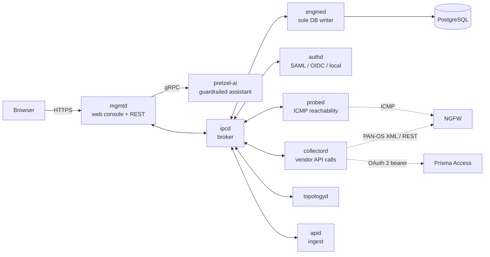

# pretzel

A management platform for a Palo Alto Networks estate: on-premises NGFW devices and Prisma Access
tenants under one inventory, driven over the vendors' own APIs.

C++17 daemons on Linux, a PostgreSQL-backed configuration store, and a TLS web console.
The AI assistant runs as a separate gRPC service, [pretzel-ai](https://github.com/starga-ze/Pretzel-AI).

---

## Quick Start

Requires Ubuntu/Debian, CMake ≥ 3.16, g++ ≥ 9 and sudo. `install` and `start` re-exec under
`sudo` automatically.

```bash
./pretzel install     # system packages, 3rd-party libraries, PostgreSQL, pgAdmin
./pretzel build       # cmake + make -> build/bin
./pretzel start       # deploy to /opt/pretzel + /etc/pretzel, start the systemd units
```

The console is then at `https://<host>` (mgmtd, port 443). The ingest API listens on 8443 and
pgAdmin on 5050.

| Command | What it does |
|---|---|
| `./pretzel install` | Dependencies and runtime services (see [Dependencies](#dependencies)) |
| `./pretzel build` | Installs build deps if missing, then cmake + make |
| `./pretzel start` / `stop` | Deploy and run the daemons under systemd / stop them |
| `./pretzel front` | Redeploy only the console's static assets, without a restart |
| `./pretzel test` | GoogleTest suite |
| `./pretzel reset` | Clear state back to a fresh install |
| `./pretzel clean` | Remove build artifacts |
| `./pretzel package` | Build an offline installer tarball for a production host (no repo, cmake or `3rd_party/` needed there) |
| `./pretzel tar` | Archive the source tree as a developer snapshot |
| `./pretzel uninstall` | Remove the deployment |

State and secrets live outside the repo: `/opt/pretzel` (binaries, static assets),
`/etc/pretzel` (startup-config, TLS certificates, `credentials.key`), `/var/lib/pretzel`
(per-daemon runtime state).

---

## Architecture



Every daemon is an event loop. Work arrives as an **event**, a service decides what to do, and the
decision leaves as an **action**. Nothing calls across a service boundary directly, so a request
crossing three daemons is three queue hops rather than a call stack.

`ipcd` brokers a length-prefixed frame protocol over unix sockets, with a versioned wire contract
and addressed daemon ids. `engined` is the only process that writes to PostgreSQL; everything else
asks it to.

### Daemons

| Daemon | Role |
|---|---|
| `ipcd` | IPC broker |
| `engined` | Sole DB writer: commits, credentials, probe results, log tailing |
| `authd` | Local accounts, SAML 2.0 SP, Okta OIDC |
| `mgmtd` | TLS web console, REST API, gRPC client to pretzel-ai |
| `probed` | ICMP reachability |
| `collectord` | PAN-OS keygen and REST/XML, Prisma Access OAuth, scheduled collection |
| `topologyd` | Topology derivation |
| `apid` | Ingest |

### What it does

**Inventory.** NGFW devices and SASE tenants are separate tables with separate shapes: a firewall
is an address you connect to, a tenant is a scope you are authorised for.

**Credential lifecycle.** Mints PAN-OS API keys from account credentials via `/api/?type=keygen`,
and picks key delivery by call path — `key=` query parameter for the XML API, `X-PAN-KEY` header
for REST. For Prisma Access it takes a `scope=tsg_id:<TSG>` bearer from the OAuth 2.0
client-credentials grant. Expiry is tracked and re-issue is scheduled.

**Health in three layers.** Network reachability, credential validity and vendor-API availability
are reported as separate signals, so an outage is attributed rather than guessed. SASE has nothing
to ping; its health is a control-plane read.

**Collection.** A connector binds one inventory object to one credential and a list of endpoints
with per-endpoint poll intervals. Endpoints carry their own path and parameters, so any call can be
tested standalone before a connector exists. PAN-OS REST paths are version-scoped
(`/restapi/v10.2/…`), and because a real estate runs several releases at once, an upgrade publishes
a *second* endpoint rather than editing the first.

**Configuration.** A commit model: an operator edits a candidate, a commit mints a new version, and
daemons converge onto it. Versions carry `pending` → `active` → `superseded`, so a daemon that
cold-restarts mid-reload loads the last known good version and never the in-flight one.

**Console.** Device status, settings and commit review, topology, API collection, a system-log
viewer aggregating every daemon's log, and the assistant.

---

## Security design

- **Secrets at rest.** Account credentials — NGFW username/password, SASE client id/secret — are
  sealed with AES-256-GCM under a key file held by one service account. Plaintext custody lives in
  a single process; every other daemon handles sealed material only. A database copy taken without
  the key file is inert.

- **Two trust models, deliberately not unified.** A PAN-OS box presents a self-signed certificate,
  so the client pins an expected fingerprint behind a first-contact gate and refuses to send the
  request at all on a mismatch — credentials are never offered to an unverified peer. A Prisma
  Access call goes to a public CA endpoint, where the chain and hostname are verified normally.

- **Single sign-on, implemented rather than imported.** A SAML 2.0 Service Provider doing XML-DSig
  verification against a pinned IdP certificate, assertion clock-skew windowing and IdP
  group-to-role mapping; plus Okta OIDC over the authorization-code flow with PKCE, `state`/`nonce`
  replay protection and RS256 ID-token verification.

- **Local accounts.** PBKDF2-SHA256 with a per-user salt, and a forced change off the factory
  default on first login.

- **Bearer tokens are never configuration.** They are minted per call and held in memory; only the
  durable credential that mints them is persisted, and only sealed.

---

## Layout

```
pretzel              CLI dispatcher
script/              build / install / start / stop / reset / test / package
3rd_party/install/   vendored dependency tree (created by ./pretzel install)
shared/              common library: ipc, event, action, router, db, http, socket, config, util
ipcd/                IPC broker
engined/             sole DB writer: commit, credentials, probe results, log tailing
authd/               local accounts, SAML 2.0 SP, Okta OIDC
probed/              ICMP reachability
collectord/          PAN-OS keygen and REST/XML, Prisma Access OAuth, collection
topologyd/           topology derivation
mgmtd/               TLS web console, REST API, gRPC client to pretzel-ai
apid/                ingest
config/              startup-config template, pgAdmin config
cert/ secret/        generated TLS material and credential key (gitignored)
tests/               GoogleTest suite
tools/mcp/           MCP server for daemon status and log tailing
docs/                design notes
```

---

## Dependencies

`./pretzel install` is idempotent and installs three groups. Build dependencies are also installed
on demand by `./pretzel build`; test and runtime failures are warnings, not fatal.

**Built from source into `3rd_party/install/`** (static, isolated from the system):

| Library | Version | Used for |
|---|---|---|
| OpenSSL | 3.2.0 | TLS, crypto, secret sealing (`no-shared`) |
| Boost | 1.84.0 | `asio`, `thread` (system + thread only, static) |
| spdlog | 1.13.0 | Logging |
| nlohmann/json | 3.11.3 | JSON |
| gRPC | 1.62.1 | mgmtd ↔ pretzel-ai transport; bundles protobuf, abseil, re2, c-ares, zlib |
| GoogleTest | 1.14.0 | `tests/` only (gmock off) |

gRPC is built against the vendored OpenSSL rather than its bundled BoringSSL: both export the same
`EVP_*`/`RSA_*` symbols, and two copies multiply-define every one of them at static link.

**APT packages:**

| Package | Used for |
|---|---|
| `build-essential`, `cmake` | Toolchain |
| `g++-9` (via `ppa:ubuntu-toolchain-r/test`) | Only if the system g++ is older than 9 |
| `libpq-dev` | `shared/db` client headers |
| `libsnmp-dev` | Net-SNMP, linked by `collectord` |
| `libxmlsec1-dev`, `zlib1g-dev`, `pkg-config` | SAML XML-DSig and AuthnRequest DEFLATE in `authd` |
| `unixodbc`, `unixodbc-dev` | ODBC headers |
| `postgresql`, `postgresql-contrib` | Database server |
| `postgresql-<major>-pgvector` | Vector column type for the corpus database (PGDG repo added if the distro has no candidate) |
| `python3-venv`, `python3-dev` | pgAdmin virtualenv |
| `curl`, `ca-certificates` | Fetching the PGDG signing key |

**Python (pip, in a dedicated virtualenv):** pgAdmin 4 8.14 + gunicorn, run headless under
`pz-pgadmin.service`. The `pgadmin4-web` apt package is avoided because it pulls in Apache and an
interactive setup script.

**Provisioned:** the `pretzel` login role, the `pretzel` database, and an empty `pretzel_rag`
database with the `vector` extension enabled. The corpus itself is built elsewhere and restored as
data; without it the assistant answers ungrounded and nothing else is affected.

---

## Tests

```bash
./pretzel test
```

Unit tests over the pure parts: IPC codec and protocol, HTTP, SAML and Okta clients, password
hashing, secret sealing, ICMP codec, settings validation, inventory projection, ingest routing.
CMake finds GoogleTest with `find_package(..., QUIET)` and skips `tests/` when it is absent.

---

## Status

Working end to end, used as a lab and demonstration environment. Active work is on the
configuration-version convergence path and on moving the assistant's transport fully to gRPC.

This is an experimental single-developer project, not a product. It is not affiliated with or
endorsed by Palo Alto Networks; product names appear only to describe what it integrates with.
